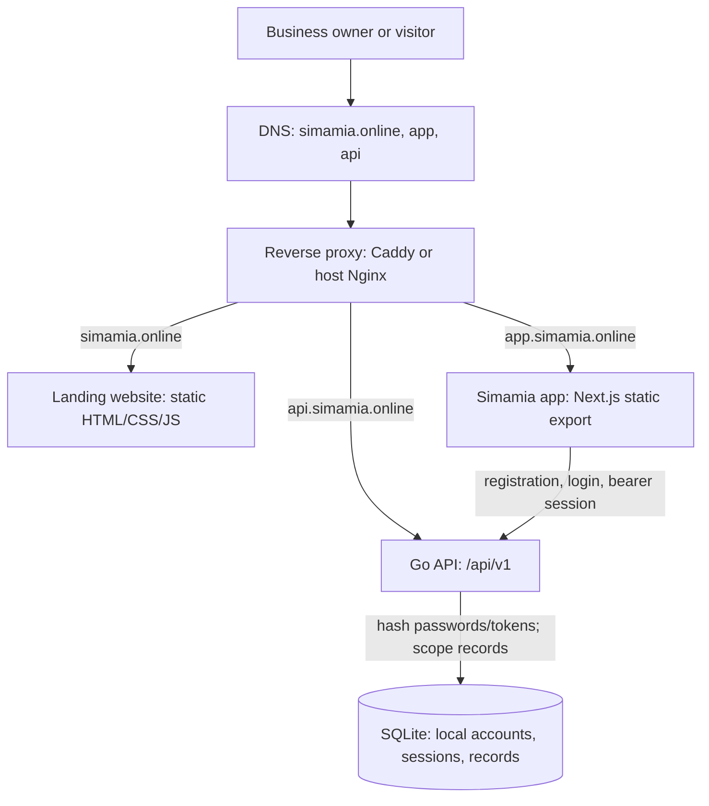
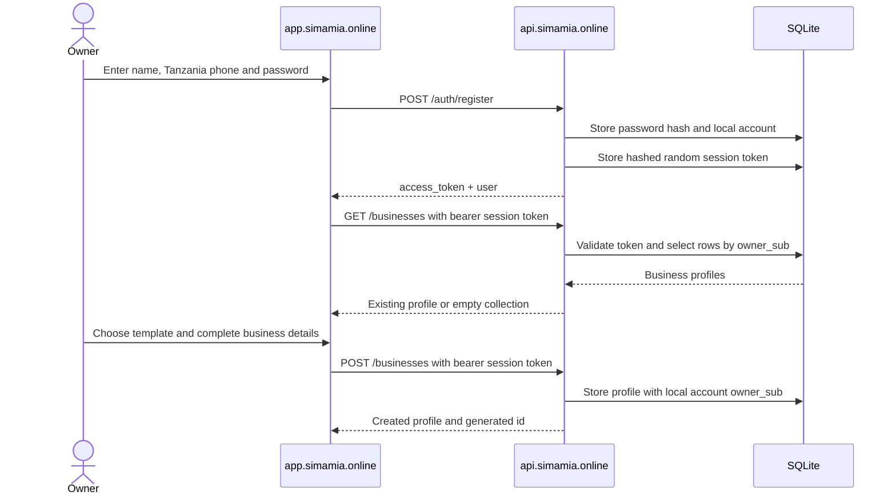
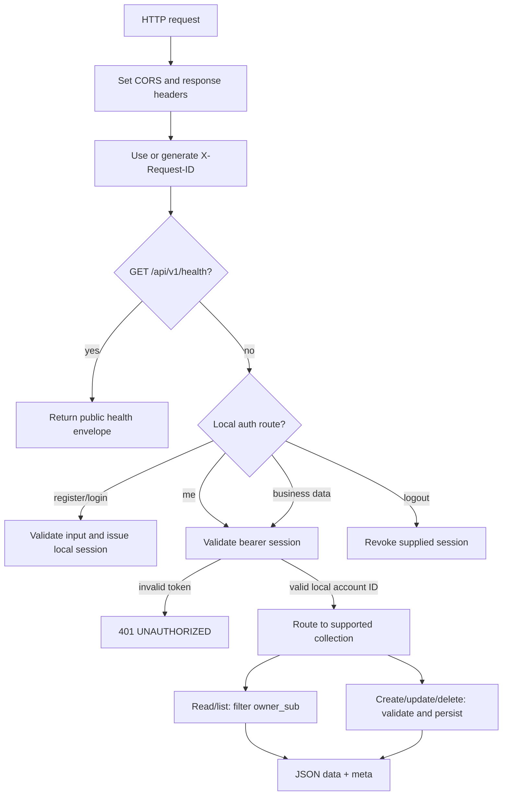

# Architecture

## Production services

The production stack has three product services and a reverse proxy. The landing site and app are static web assets in Nginx containers. The Go API persists business records and local account/session data in a named SQLite volume. Caddy terminates TLS in the standalone deployment; the existing VPS deployment uses host Nginx and loopback ports instead.

## Sign-in and first-use setup

The browser app offers local account creation and sign-in with a Tanzania phone number and password. Registration stores a salted PBKDF2-HMAC-SHA-512 password hash, creates a random bearer session token, and returns the signed-in account. The API stores only a SHA-256 hash of each session token. Once signed in, the app shows business onboarding if the account has no profile. Onboarding has two steps: choose one of eight business templates, then enter the business name and Tanzania phone number.

A normal session lasts 12 hours; selecting “Remember me” creates a 30-day session. `POST /auth/logout` revokes the current token. Password reset and account recovery are not implemented.

## API request handling

The Go handler sets CORS and security headers, assigns a request ID, answers `/health` without account auth, dispatches account registration/login/logout, then validates a local bearer session for protected operations. It filters business records by the session's local account ID. SQLite writes use one connection and WAL mode.

## Tenant boundary today

The storage boundary is the local account ID stored in `owner_sub`. Every business record belongs to the account that created it; another account cannot fetch, edit, delete, or list that record. The current model does not yet implement business-level membership: a shared shop with multiple staff accounts needs membership and role support before those accounts can safely share one business workspace.

## Important implementation constraints

- SQLite is single-server storage and API connections are limited to one open connection. Do not run multiple API replicas against the same database file.
- On a newly initialized empty database, example rows are seeded under `local-preview`; registered account requests are scoped to their own ID and will not see those rows.
- Orders refer to customers and services by display name strings, not enforced foreign keys.
- Payment ledger rows are calculated from `orders.amount` and `orders.paid` on each request. The ledger is not an independently writable table.
- Template selection lives in the business profile. The API does not enforce template-specific field schemas or state transitions yet.
- Account recovery and login rate limiting are not implemented; deployments exposed to the internet should add trusted-proxy abuse controls.

See [data model](/concepts/data-model), [authentication](/concepts/authentication), and [production limits](/operations/limits) for details.
